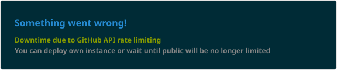

### Hey there! 👋🏻🖖🏻🥳

🔭 Constantly working on being best papa in the world & promoting Blazor usage throughout the Web.

🌱 Currently learning home automation via Home Assistant with [EnOcean](https://github.com/henningkerstan/enocean-async) hardware.

👯 Collaborating on the [new EnOcean integration](https://github.com/home-assistant/core/pull/161251) for Home Assistant.

🤔 Striving for help with C# P/Invoke regarding FLAC's C++ DLL to release [TZN Flake](../../../tzn-flake) some day - about 100 CDs are waiting…

💬 Ask me about anything you’d like. Seriously.

📫 How to reach me: e-mail, GitHub or LinkedIn.

😄 Pronouns: he/him, but _human_ is preferred.

⚡ Fun fact: Always be yourself! Unless you can be Batman, then always be Batman. 🦇🤘🏻

