<!--
  Your profile README. Everything outside the profilescape markers is yours to edit.
  Everything between the markers is rewritten by .github/workflows/profilescape.yml.
-->

### Hi, I'm Your Name

Software engineer who likes building things people enjoy using. Replace this paragraph with a sentence or two about what you do and what you care about.

- Currently working on **a project you are proud of**
- Learning **something new**
- Ask me about **topics you love talking about**
- Reach me at **your website, email or social handle**

<!-- profilescape:start -->

<picture>
  <source media="(prefers-color-scheme: dark)" srcset="https://raw.githubusercontent.com/Eagle3386/Eagle3386/profilescape-output/hero-dark.svg" />
  
</picture>

<picture>
  <source media="(prefers-color-scheme: dark)" srcset="https://raw.githubusercontent.com/Eagle3386/Eagle3386/profilescape-output/3d-dark.svg" />
  
</picture>

<picture>
  <source media="(prefers-color-scheme: dark)" srcset="https://raw.githubusercontent.com/Eagle3386/Eagle3386/profilescape-output/stack-dark.svg" />
  
</picture>

<picture>
  <source media="(prefers-color-scheme: dark)" srcset="https://raw.githubusercontent.com/Eagle3386/Eagle3386/profilescape-output/stats-dark.svg" />
  
</picture>

<picture>
  <source media="(prefers-color-scheme: dark)" srcset="https://raw.githubusercontent.com/Eagle3386/Eagle3386/profilescape-output/grid-dark.svg" />
  
</picture>

<picture>
  <source media="(prefers-color-scheme: dark)" srcset="https://raw.githubusercontent.com/Eagle3386/Eagle3386/profilescape-output/languages-dark.svg" />
  
</picture>

<table>
  <tr>
    <td width="50%">
<a href="https://github.com/MudBlazor/MudBlazor">
<picture>
  <source media="(prefers-color-scheme: dark)" srcset="https://raw.githubusercontent.com/Eagle3386/Eagle3386/profilescape-output/repo-mudblazor-mudblazor-dark.svg" />
  
</picture>
</a>
    </td>
    <td width="50%">
<a href="https://github.com/Eagle3386/tzn-flake">
<picture>
  <source media="(prefers-color-scheme: dark)" srcset="https://raw.githubusercontent.com/Eagle3386/Eagle3386/profilescape-output/repo-eagle3386-tzn-flake-dark.svg" />
  
</picture>
</a>
    </td>
  </tr>
</table>

<table>
  <tr>
    <td width="50%">
<a href="https://github.com/Eagle3386/Aspire-Blazor-gRPC-JSON-Demo">
<picture>
  <source media="(prefers-color-scheme: dark)" srcset="https://raw.githubusercontent.com/Eagle3386/Eagle3386/profilescape-output/repo-eagle3386-aspire-blazor-grpc-json-demo-dark.svg" />
  
</picture>
</a>
    </td>
    <td width="50%">
<a href="https://github.com/Eagle3386/wxif">
<picture>
  <source media="(prefers-color-scheme: dark)" srcset="https://raw.githubusercontent.com/Eagle3386/Eagle3386/profilescape-output/repo-eagle3386-wxif-dark.svg" />
  
</picture>
</a>
    </td>
  </tr>
</table>

<!-- profilescape:end -->

---

## Getting started

_Delete this section once your cards show up._

1. **Name the repository after your username.** GitHub shows the README of the repository named exactly like your account (for example `octocat/octocat`) on your profile. If you picked another name, rename it under **Settings → General**.
2. **Run the workflow once.** Open the **Actions** tab, enable workflows if GitHub asks, choose **Profilescape** and click **Run workflow**. Your cards appear between the markers above in about a minute, then refresh every day.
3. **Make it yours.** Edit the intro above, then change `theme`, `cards` and the other options in [`.github/workflows/profilescape.yml`](.github/workflows/profilescape.yml). Try every card and theme in the [playground](https://chethandvg.github.io/profilescape) first.
4. **Optional: count private contributions.** The default workflow token only sees public activity. Create a [fine-grained personal access token](https://github.com/settings/personal-access-tokens/new) for your account with **All repositories** and the read-only **Contents** and **Metadata** repository permissions, save it under **Settings → Secrets and variables → Actions** as `PROFILESCAPE_TOKEN`, and the workflow picks it up automatically.

GitHub pauses scheduled workflows in repositories with no activity for 60 days. If your cards stop updating, re-enable the workflow from the **Actions** tab.

Made with [Profilescape](https://github.com/chethandvg/profilescape).
