### Hey there, I'm Martin! 👋🏻🖖🏻🥳

Senior Software engineer who likes building things people enjoy using.

🔭 Constantly working on being best papa in the world & promoting Blazor usage throughout the Web.  
🌱 Currently learning home automation via Home Assistant with [EnOcean](https://github.com/henningkerstan/enocean-async) hardware.  
👯 Collaborating on the [new EnOcean integration](https://github.com/home-assistant/core/pull/161251) for Home Assistant.  
🤔 Striving for help with C# P/Invoke for FLAC's C++ DLL to release [TZN Flake](../../../tzn-flake) some day - ~100 CDs are waiting…  
💬 Ask me about anything you’d like. Seriously.  
📫 Reach me via e-mail, GitHub or LinkedIn.  
😄 Pronouns: he/him, but _human_ is preferred.  
⚡ Fun fact: Always be yourself! Unless you can be Batman, then always be Batman. 🦇🤘🏻

<!-- profilescape:start -->

<picture>
  <source media="(prefers-color-scheme: dark)" srcset="https://raw.githubusercontent.com/Eagle3386/Eagle3386/profilescape-output/hero-dark.svg" />
  
</picture>

<picture>
  <source media="(prefers-color-scheme: dark)" srcset="https://raw.githubusercontent.com/Eagle3386/Eagle3386/profilescape-output/3d-dark.svg" />
  
</picture>

<picture>
  <source media="(prefers-color-scheme: dark)" srcset="https://raw.githubusercontent.com/Eagle3386/Eagle3386/profilescape-output/stack-dark.svg" />
  
</picture>

<picture>
  <source media="(prefers-color-scheme: dark)" srcset="https://raw.githubusercontent.com/Eagle3386/Eagle3386/profilescape-output/stats-dark.svg" />
  
</picture>

<picture>
  <source media="(prefers-color-scheme: dark)" srcset="https://raw.githubusercontent.com/Eagle3386/Eagle3386/profilescape-output/grid-dark.svg" />
  
</picture>

<picture>
  <source media="(prefers-color-scheme: dark)" srcset="https://raw.githubusercontent.com/Eagle3386/Eagle3386/profilescape-output/languages-dark.svg" />
  
</picture>

<table>
  <tr>
    <td width="50%">
<a href="https://github.com/MudBlazor/MudBlazor">
<picture>
  <source media="(prefers-color-scheme: dark)" srcset="https://raw.githubusercontent.com/Eagle3386/Eagle3386/profilescape-output/repo-mudblazor-mudblazor-dark.svg" />
  
</picture>
</a>
    </td>
    <td width="50%">
<a href="https://github.com/Eagle3386/tzn-flake">
<picture>
  <source media="(prefers-color-scheme: dark)" srcset="https://raw.githubusercontent.com/Eagle3386/Eagle3386/profilescape-output/repo-eagle3386-tzn-flake-dark.svg" />
  
</picture>
</a>
    </td>
  </tr>
</table>

<table>
  <tr>
    <td width="50%">
<a href="https://github.com/Eagle3386/Aspire-Blazor-gRPC-JSON-Demo">
<picture>
  <source media="(prefers-color-scheme: dark)" srcset="https://raw.githubusercontent.com/Eagle3386/Eagle3386/profilescape-output/repo-eagle3386-aspire-blazor-grpc-json-demo-dark.svg" />
  
</picture>
</a>
    </td>
    <td width="50%">
<a href="https://github.com/Eagle3386/wxif">
<picture>
  <source media="(prefers-color-scheme: dark)" srcset="https://raw.githubusercontent.com/Eagle3386/Eagle3386/profilescape-output/repo-eagle3386-wxif-dark.svg" />
  
</picture>
</a>
    </td>
  </tr>
</table>

<!-- profilescape:end -->
